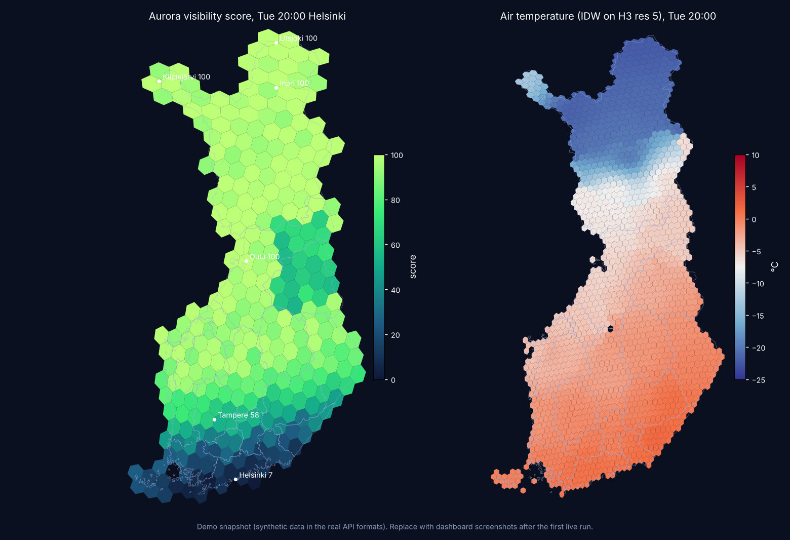
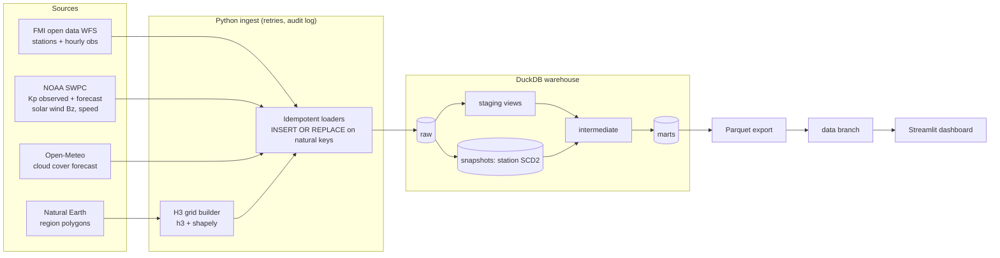

# Finland Weather & Aurora Grid

[](https://github.com/munyingi/finland-weather-aurora/actions/workflows/ci.yml)
[](https://github.com/munyingi/finland-weather-aurora/actions/workflows/pipeline.yml)

A geospatial data engineering pipeline for **all of Finland**. It does two things:

1. **Weather on a hexagon grid.** Hourly observations from FMI weather stations are interpolated onto ~1,700 H3 hexagons that cover the mainland and Åland. They are rolled up to the 19 regions (maakunnat) and checked against rules for extreme weather.
2. **Aurora spotting.** Every hour, each of ~280 larger hexagons gets an **aurora visibility score**. The score combines NOAA geomagnetic activity and solar wind, the hexagon's geomagnetic latitude, how dark it is (solar position) and the Open-Meteo cloud forecast. The result is a ranked "where to go tonight" list of 23 well-known viewing spots.

A scheduled GitHub Actions job runs the pipeline every 3 hours. A Streamlit dashboard reads the published output.

**Live dashboard:** _add your Streamlit URL here after deploying_



*Demo snapshot rendered from synthetic data. Live dashboard screenshots go in `docs/images/`.*

---

## Architecture



| Layer | What happens |
|---|---|
| **Ingest** (`ingest/`) | Watermark-based incremental pulls with a 3 h overlap for late values. Requests are chunked to respect FMI's limits. Every source is logged in `raw.ingest_runs`, and one failing API does not stop the others. |
| **Staging** | Typing and renaming, plus physical-range validity flags driven by the `fmi_parameters` seed. Kp products are ranked observed > estimated > predicted. |
| **Intermediate** | Stations matched to SCD2 metadata, cell-to-station candidate pairs, and an hourly space-weather spine with a 1 h solar-wind nowcast. |
| **Marts** | IDW-interpolated hourly weather (incremental), regional daily stats, extreme-weather events, aurora scores, viewing spots and pipeline health. |
| **Serve** | Small Parquet files force-pushed to a single-commit `data` branch, read by Streamlit. |

### dbt lineage

```
sources ─┬─ stg_fmi__observations ── int_stations ──┬─ int_observations_valid ─┬─ fct_weather_cell_hourly ── fct_weather_region_daily
         │   stg_fmi__stations ── snap_fmi_stations ┘                          └─ fct_station_daily ── fct_weather_events
         ├─ stg_grid__cells ── dim_cells ── int_cell_station_pairs
         ├─ stg_swpc__kp ─┬─ int_space_weather_hourly ──┐
         ├─ stg_swpc__solar_wind ┘                      ├─ fct_aurora_cell_hourly ── mart_aurora_spots_hourly ── mart_aurora_tonight
         ├─ stg_openmeteo__cloud ───────────────────────┘
         └─ ingest_runs ── mart_pipeline_health
```

Run `dbt docs generate && dbt docs serve` (with the args from the Makefile) for the interactive graph.

---

## Geospatial techniques

- **H3 hexagonal grid.** Resolution 5 (~250 km² per cell) holds weather and resolution 4 (~1,770 km² per cell) holds the aurora score. Every res-5 cell knows its res-4 parent. Cells are generated per region polygon. Archipelagos (Åland) fall back to *overlap* containment, because a centroid test drops most small islands.
- **Inverse distance weighting** (power 2), computed **per measure and per hour**. Each cell uses the nearest 4 stations that actually reported *that* measure in *that* hour, within 120 km. A station without a snow sensor therefore never pulls snow depth towards zero. Cells with no station in range are left empty rather than guessed.
- **Great-circle distance, solar position and geomagnetic latitude in pure SQL** (`transform/macros/geo.sql`). No spatial extension is needed, so the models run on any DuckDB build. A dbt test checks the solar-position macro against an independent implementation (astral) to within 0.5°.
- **Region assignment by point-in-polygon** in Python (shapely), with region geometry simplified from Natural Earth.

## How the aurora score works

```
aurora_score = 100 × geomagnetic chance × darkness × clear sky
```

| Factor | Rule |
|---|---|
| Geomagnetic chance | The oval's southern edge sits at `67° − 2° × Kp` geomagnetic latitude. Aurora is seen low in the north about 2° south of that edge. A logistic curve on the cell's distance from that line gives 0 to 1. Southward Bz (≤ −5 nT: +0.5 Kp, ≤ −10 nT: +1) and wind ≥ 600 km/s (+0.5) raise the *effective* Kp. |
| Darkness | 0 with the sun above −6° (civil twilight), 1 below −12° (nautical), linear in between |
| Clear sky | 1 − cloud cover |

All constants are dbt `vars` in `transform/dbt_project.yml`, so the model can be tuned without touching SQL. Two dbt **unit tests** pin the behaviour. A clear December night in Lapland scores *excellent* and Helsinki at the same Kp scores *possible*. Full cloud or daylight scores zero, a missing Kp gives `no_data` rather than a guess, and strongly southward Bz boosts the effective Kp.

> This is a transparent heuristic built for a portfolio project, not an official forecast. For real alerts, use FMI's *Revontulet ja avaruussää* service.

## Data quality

- **47 dbt data tests and 2 unit tests**, including uniqueness of every mart grain, referential integrity, physical value ranges and accepted values.
- **Source freshness** on observations, Kp and cloud cover (warn after 6 h, error after 24 h).
- **Out-of-range readings** (e.g. a 99.9 °C sensor glitch) stay in staging with `is_valid = false`. They are counted in `mart_pipeline_health` and never reach interpolation or events.
- **Late data**: ingestion re-reads 3 h before the watermark, and the incremental model re-merges the last 6 h.
- **SCD Type 2 station history** (`snap_fmi_stations`) records renames, moves and closures.
- **Pipeline health tab**: last success, failures in the last 24 h and data freshness per source.

## Extreme weather rules

Rules live in `transform/seeds/event_thresholds.csv`. Adding an event type means adding one CSV row, with no new SQL. Events are evaluated on real station readings, not interpolated values.

| Event | Rule |
|---|---|
| severe_frost / hard_frost | daily min ≤ −25 °C / ≤ −15 °C |
| heat_day (hellepäivä) | daily max ≥ 25 °C |
| storm / strong_gusts | 10 min mean wind ≥ 21 m/s / gusts ≥ 25 m/s |
| heavy_rain_hour | ≥ 10 mm in an hour |
| heavy_snowfall | snow depth up ≥ 10 cm within the day |
| freeze_thaw | temperature crossed 0 °C (slippery roads) |

---

## Run it

Requires Python 3.11+.

```bash
git clone https://github.com/munyingi/finland-weather-aurora.git
cd finland-weather-aurora
python -m venv .venv && source .venv/bin/activate
make install

make demo     # offline: synthetic data in the real API formats -> dbt build -> publish
make live     # real data from FMI, NOAA SWPC and Open-Meteo
make app      # dashboard at http://localhost:8501
make test     # pytest
```

`make demo` needs no network. `DemoClient` serves synthetic payloads in the exact FMI WFS XML, SWPC JSON and Open-Meteo JSON formats. They flow through the real parsers, loaders and dbt models, which is what CI runs on every push. The demo scenario is a cold, clear night in Lapland, a front over the south coast and a storm near Kp 4.

Useful variables: `FWA_WAREHOUSE` (DuckDB path), `FWA_BACKFILL_HOURS` (first-run history, max 168), `FWA_FMI_CHUNK_HOURS`.

## Deploy

1. **Scheduled pipeline.** The `Pipeline` workflow runs every 3 hours. Trigger it once by hand from the Actions tab (*Run workflow*). It keeps the DuckDB warehouse in the Actions cache and force-pushes the dashboard files to the `data` branch.
2. **Dashboard.** On [share.streamlit.io](https://share.streamlit.io), create an app from this repo with branch `main` and main file `dashboard/app.py`. It reads from the `data` branch automatically. Until the first pipeline run, it shows the bundled demo snapshot with a banner saying so.

## Project layout

```
ingest/              Python extract + load (FMI, SWPC, Open-Meteo, H3 grid, demo client, publish)
transform/           dbt project: staging -> intermediate -> marts, seeds, snapshot, macros, tests
dashboard/           Streamlit app + bundled demo snapshot
tests/               pytest: parsers, grid, idempotency, incremental windows, failure isolation
.github/workflows/   CI (lint, tests, end-to-end demo) and the scheduled pipeline
```

## Design decisions

- **DuckDB + dbt, no cloud warehouse.** The pipeline costs nothing to run, finishes in seconds and reproduces exactly on any laptop or CI runner.
- **Geometry in Python, analytics in SQL.** H3 and polygon work run once in the loader. Distance and astronomy are plain SQL macros, so no DuckDB extension downloads are needed.
- **A single-commit `data` branch** instead of committing data to `main` keeps the repo small forever and gives Streamlit a stable URL.
- **Fail soft, log loudly.** Each source loads independently, and failures go to `raw.ingest_runs` and the health tab rather than killing the run.

## Limitations and next steps

- The aurora model uses a centred-dipole geomagnetic latitude and a simple oval rule. A natural upgrade is ingesting FMI's IMAGE magnetometer data or NOAA's OVATION aurora probability grid.
- IDW ignores elevation and coastline effects. Kriging, or a lapse-rate correction from a DEM, would improve temperature in Lapland's fells.
- Light pollution is not modelled. Adding a VIIRS night-lights layer would help rank spots near cities.
- The warehouse lives in the Actions cache. For long-term history, sync raw tables to object storage (for example MotherDuck or S3).

## Data sources and licences

- [Finnish Meteorological Institute open data](https://en.ilmatieteenlaitos.fi/open-data), CC BY 4.0
- [NOAA Space Weather Prediction Center](https://www.swpc.noaa.gov/), public domain
- [Open-Meteo](https://open-meteo.com/), CC BY 4.0
- [Natural Earth](https://www.naturalearthdata.com/) admin-1 boundaries, public domain
- [H3](https://h3geo.org/) hexagonal grid

Built by **Samwel Munyingi** · [LinkedIn](https://linkedin.com/in/samwel-munyingi-352a88161) · [GitHub](https://github.com/munyingi)
